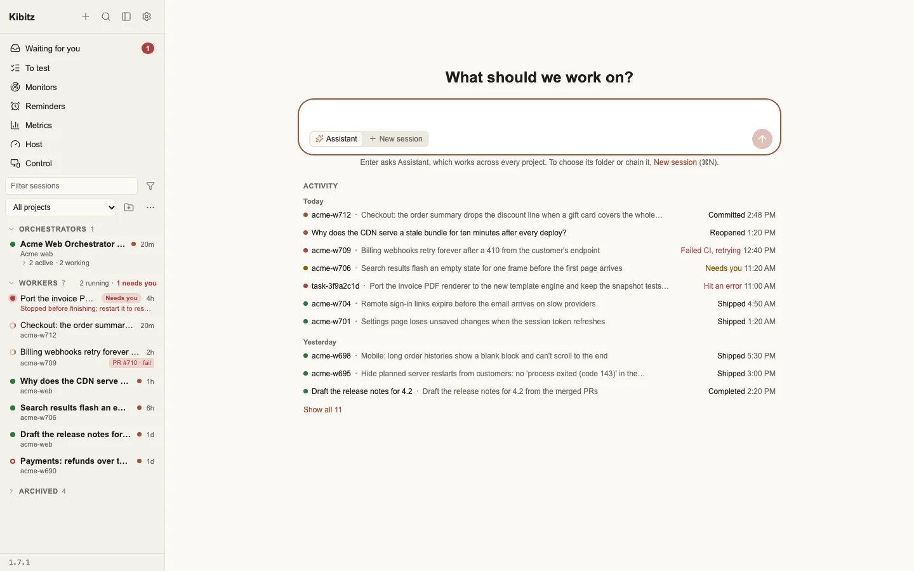
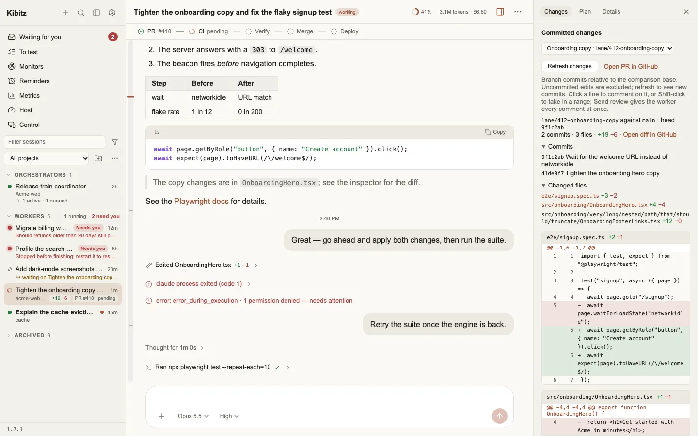
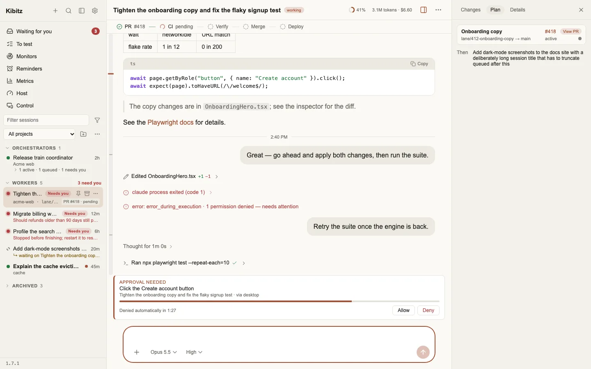
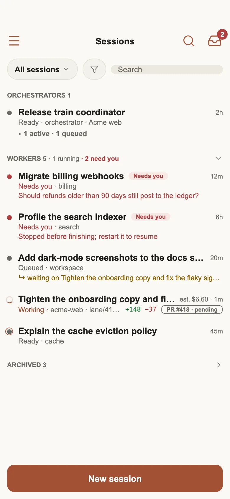
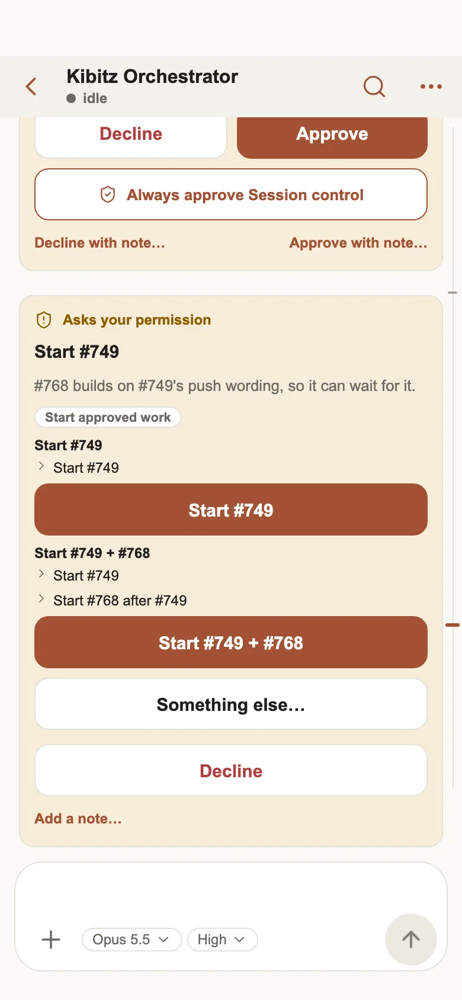

<!-- Generated by the Kibitz release from packaging/public-readme/README.template.md; edits here are replaced on the next release. -->

# Kibitz

This repository holds Kibitz's public releases: the Mac app, the `kbz` package for macOS and Linux, and the signed apt repository that https://aagdere.github.io/kbz serves.

Kibitz is a team of coding agents that you host yourself. It works in your
GitHub repositories and lands changes as pull requests. You run it on your own
Mac and talk to it from the desktop app.

- **One orchestrator per project.** A project is one repository. You tell its
  orchestrator what you want changed, and it plans the work.
- **Workers that open and land pull requests.** The orchestrator starts a
  worker for each change, on its own branch. The worker opens a pull request,
  and Kibitz merges it once the checks you chose pass.
- **An assistant across all your projects.** Ask it anything, or hand it work
  for any project, from one conversation.
- **You stay in charge.** When an agent needs a decision, a password or a
  risky step, it asks you on a card, and nothing happens until you answer.
- **Desktop and iPhone apps.** The Mac app is where you set Kibitz up and
  watch it work. The iPhone app follows the same sessions and cards.

<picture>
  <source media="(prefers-color-scheme: dark)" srcset="images/desktop-home-activity-dark.webp">
  
</picture>

## Contents

- [Requirements](#requirements)
- [Install](#install)
- [First run](#first-run)
- [Using Kibitz](#using-kibitz)
- [The kbz command](#the-kbz-command)
- [Privacy](#privacy)
- [Updating, uninstalling and your data](#updating-uninstalling-and-your-data)
- [Troubleshooting](#troubleshooting)
- [Getting help](#getting-help)

## Requirements

- A Mac with Apple silicon.
- A GitHub account, and the repositories you want Kibitz to work in. A test
  repository is the best first one.
- An account for the models: an [OpenRouter](https://openrouter.ai) account,
  or a Claude, ChatGPT or Google subscription.

## Install

One line in Terminal installs the Kibitz app:

```bash
curl -fsSL https://aagdere.github.io/kbz/install | sh
```

It downloads the signed, notarized app, checks its checksum and signature,
puts it in Applications and opens it. You don't need Homebrew.

Or install it with [Homebrew](https://github.com/aagdere/homebrew-kbz):

```bash
brew install --cask aagdere/kbz/kbz    # the Kibitz app
```

The app installs everything else itself the first time it opens. Homebrew
may ask you to trust the tap once: `brew trust aagdere/kbz`.

### The command line only

On a Mac with no screen, or an Intel Mac, install the `kbz` command and
service instead of the app:

```bash
brew install aagdere/kbz/kbz
kbz setup                      # choose what this Mac does
brew services start kbz       # run it now and at login
```

The same install line also works on Debian, Ubuntu and Raspberry Pi OS (amd64
and arm64). It installs the `kbz` package from a signed apt repository;
then run `sudo kbz setup`.

## First run

The first time it opens, the app walks you through setup in the
**"Set up Kibitz"** window. You don't need a terminal or to edit any files.
You can stop at any step with **"Finish setup later"**, and the wizard opens
where you left off.

1. **Choose this Mac's role.** Pick **"This is my Kibitz"** for a first
   install: the Kibitz server runs on this Mac. **"Connect this device to my
   Kibitz"** and **"Just the app"** are for a Mac that joins a Kibitz running
   somewhere else.
2. **Allow computer use.** Kibitz lists the macOS permissions it needs to
   look at and use your Mac: Screen Recording, Accessibility and App
   Management. Press each button and turn on the switch in System Settings.
   The list updates by itself. Or press **"Continue without them"** and allow
   them later in Settings → This Mac.
3. **Install Kibitz.** Kibitz checks that Git is installed, then
   **"Install Kibitz"** installs the server the app carries and starts it in
   the background. It starts again each time you log in. If a Kibitz server
   already runs on this Mac, the button reads
   **"Use the server on this Mac"** instead.
4. **Connect GitHub.** Press **"Sign in with GitHub"**, then
   **"Copy code and open GitHub"**, paste the code on github.com and approve.
   No password or token passes through Kibitz.
5. **Choose a model.** Sign in to OpenRouter, or open
   **"Or sign in with a subscription"** for Claude, ChatGPT or Google. Then
   pick **"The model every session starts on"**.
6. **Name your assistant.** Give the assistant that works across all your
   projects a name, or press **"Skip"** to keep "Assistant".
7. **Choose what agents may do.** Pick **"Conservative"**, **"Balanced"** or
   **"Full access"** once; Settings → Permissions switches it later.
8. **Add projects.** Press **"Choose a folder…"** and choose a folder on
   your Mac: it becomes a project, named after the folder, with its own
   orchestrator. Any folder works, a git repository or not; a GitHub
   repository's issues and pull requests are used there. Add more with
   **"Add another folder…"**, or none with **"Add projects later"**.
9. **Add integrations (optional).** Push notifications, phone calls,
   1Password and Gmail. Skip them now if you like: they stay in
   Settings → Integrations.
10. **Start working.** Press **"Open the orchestrator"** and ask for
   something small first, such as "Add a short description to the README".

The [setup guide](SETUP.md) goes through each screen in detail.

<picture>
  <source media="(prefers-color-scheme: dark)" srcset="images/desktop-chat-changes-dark.webp">
  
</picture>

## Using Kibitz

### Day to day

Open a project's orchestrator and say what you want: "Fix the flaky signup
test", "Add dark mode to the settings page". The orchestrator files the work,
starts a worker on its own branch for each change, and follows it through. The
worker opens a pull request, and it lands the way you chose for the project:

- **"Local verify only"**: Kibitz runs the repository's own checks on your Mac
  and merges when they pass. No CI needed.
- **"GitHub-hosted runners"**: Kibitz merges once CI passes on GitHub.
- **"Self-hosted runners"**: Kibitz merges once CI passes on your own runners.

You see each step in the session: the plan, the commits, the pull request, its
checks and the merge.

### Cards

When an agent needs you, it asks on a card rather than guessing: a decision
between options, approval for a risky step, a password, or a sign-in code.
Every card you haven't answered waits in **Waiting for you**. You answer with
one tap, or write your own answer, and the agent carries on.

<picture>
  <source media="(prefers-color-scheme: dark)" srcset="images/desktop-approval-dark.webp">
  
</picture>

With the iPhone app and push notifications set up, cards reach your phone
too, and you can approve or decline from the Lock Screen.

<p>
  <picture>
    <source media="(prefers-color-scheme: dark)" srcset="images/iphone-list-dark.webp">
    
  </picture>
  <picture>
    <source media="(prefers-color-scheme: dark)" srcset="images/iphone-approval-cards-dark.webp">
    
  </picture>
</p>

The iPhone app isn't on the App Store yet. Once you have it, `kbz pair`
on your Kibitz server shows the QR code it pairs with.

### The assistant

The assistant is one conversation that works across all your projects. Type
on the home screen and it answers: it does quick things itself, hands project
work to the right orchestrator, and tells you what's going on everywhere.
Rename it any time in Settings → Assistant.

### Adding projects

Press **"Add project"**, the folder button beside the project list in the
sidebar, and choose a folder: that folder is the project, with its own
orchestrator and its own settings. A git repository, a folder of its
checkouts, or a plain folder all work, and nothing else is asked.

### Models and effort

Kibitz runs on the models you signed in to: through OpenRouter, or your
Claude, ChatGPT or Google subscription. Settings → Models & effort schedule
sets the model and the effort each kind of session starts with:
orchestrators, workers and the assistant. It can also lower the effort on a
schedule, such as on weekends. Every session's model and effort can also be
changed from the chips under its message box.

## The kbz command

The `kbz` command comes with every install. In the app it runs behind
the scenes. With the command-line install, you use it directly:

```text
Usage: kbz <command>

  setup [server|device|app]   choose what this machine does
  setup device --server <url> <code>
                              make this a device of your Kibitz and pair it, with
                              the line Settings > Computer controllers shows
  pair --server <url> <code>  pair this computer controller the same way
  pair                        on your Kibitz server: show a QR code and a short
                              code to pair the Kibitz iPhone app with
  unpair                      forget this computer controller's pairing
  gadget enable|disable       make this Pi itself the computer's USB keyboard and
                              mouse (no CH9329 adapter needed), or stop that
  gadget recover              build it again and reset the Pi's USB device port,
                              when the computer stopped taking its keyboard and
                              mouse (Kibitz does this by itself when asked)
  gadget status               show how that is set up
  role                        show what this machine does
  update                      update a connected device's kbz now (it also
                              updates by itself when no one is controlling it)
  run                         run it (the kbz service does this)
  version                     show the installed version

Roles:
  server   This is my Kibitz: Runs the Kibitz server here: it works on your repositories, and your apps and devices connect to it.
  device   Connect this device to my Kibitz: Runs only the device helper: on Linux, a computer controller (an HDMI capture of another computer's screen and a USB keyboard-and-mouse adapter in it), paired with your Kibitz by the line Settings > Computer controllers shows.
  app      Just the app: Runs nothing in the background: use the Kibitz apps with a Kibitz that runs elsewhere.
```

`kbz setup` changes a machine's role at any time, with nothing to
reinstall. The `kbz` service runs `kbz run`: Homebrew starts it with
`brew services start kbz`, and on Linux it's the `kbz` systemd
service.

## Privacy

- **Nothing of anyone else's.** A fresh install carries no one else's
  settings, accounts or data. Every release is checked for personal data
  before it's published.
- **Your data stays on your machine.** Your sessions, projects, settings and
  secrets live on the Mac that runs your Kibitz server. Kibitz talks to
  GitHub and to the model provider you signed in to, as your accounts.
- **Telemetry is off until you turn it on.** Settings → Privacy →
  "Send usage and health reports" shows, field by field, the report it would
  send. While it's off, Kibitz sends nothing.
- **Agents run in a sandbox.** A worker's commands reach only your Kibitz
  server and this Mac's own `localhost`, plus the hosts you allow for its
  project. Kibitz pushes, opens pull requests and merges itself, outside the
  sandbox.
- **You approve what matters.** Risky steps, outgoing messages and sign-ins
  wait for your answer on a card.

## Updating, uninstalling and your data

**Updating.** The app updates itself. The command-line install updates with
`brew upgrade kbz`, or `sudo apt upgrade` on Linux.

**Where things live.**

| What | Where |
| --- | --- |
| Settings, sessions, projects, the vault | `~/.glm-console` |
| The server the app installed | `~/Library/Application Support/Kibitz/server` |
| Its background service | `~/Library/LaunchAgents/app.kibitz.server.plist` |
| The server's log | `~/Library/Logs/Kibitz/server.log` |
| The command-line install's log | `$(brew --prefix)/var/log/kbz.log` |

**Uninstalling.** Quit Kibitz, then stop its server and remove the app:

```bash
launchctl bootout gui/$(id -u)/app.kibitz.server
launchctl bootout gui/$(id -u)/app.kibitz.server.logrotate
rm -f ~/Library/LaunchAgents/app.kibitz.server.plist ~/Library/LaunchAgents/app.kibitz.server.logrotate.plist
brew uninstall --zap --cask kbz    # or drag Kibitz from Applications to the Trash
```

For the command-line install: `brew services stop kbz`, then
`brew uninstall kbz`.

Your data stays in `~/.glm-console` until you delete it. It holds your
vault and your sessions, so keep it if you may come back:
`rm -rf ~/.glm-console` removes it for good.

## Troubleshooting

**An organization's repositories don't show up.** The organization may use
single sign-on (SAML SSO), or restrict which apps may read its data. Kibitz
signs in through the GitHub CLI, so:

- **Single sign-on:** in your GitHub account's settings, open Applications,
  then Authorized OAuth Apps, then GitHub CLI, and press **Authorize** beside
  the organization.
- **App approval:** on the same page, press **Request** beside the
  organization, and ask one of its owners to approve it.

The **"Add projects"** step, and later the project's menu, run Kibitz's
GitHub access checks and name the fix for each one that fails. You can
always type `owner/name` for any repository you can clone.

**Kibitz can't see or use the screen.** Open Settings → This Mac, which lists
Screen Recording, Accessibility and App Management with their state, and turn
on the missing one in System Settings. macOS applies Screen Recording only
after you quit and reopen Kibitz.

**A worker's command is blocked from the network.** Workers reach only the
hosts their project allows. The session says which host was blocked and asks
you on a card: allow it for that session, always for that project, or not at
all. To change the list yourself, open the project's menu, choose **Edit …**,
and use **Network access**: tick GitHub, npm or PyPI, or type hosts, one per
line (`*.example.com` covers every subdomain).

**Something else.** The server's log is in `~/Library/Logs/Kibitz/server.log`,
and Settings → Diagnostics lists the app's own crashes and hangs.

## Getting help

Report a problem or ask a question in [the issue tracker](https://github.com/aagdere/kbz/issues).
Please include `kbz version`, or the version shown at the bottom of the
app's sidebar, and what you saw.

---

The Homebrew recipes are in the tap, [aagdere/homebrew-kbz](https://github.com/aagdere/homebrew-kbz). This page was written for Kibitz 0.1.4214.
